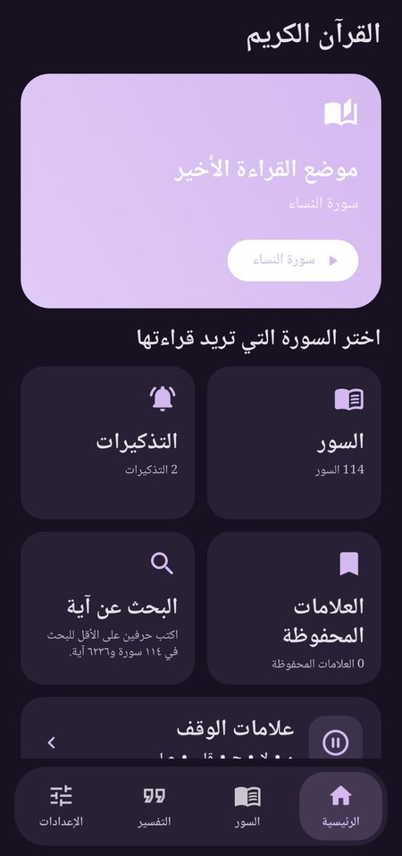
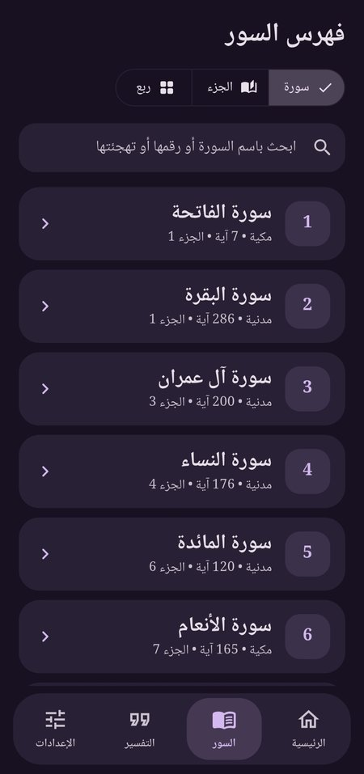
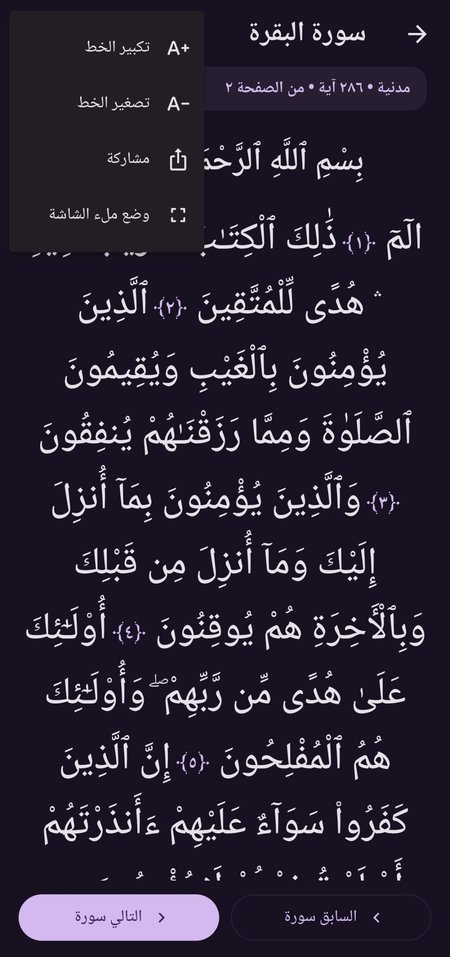
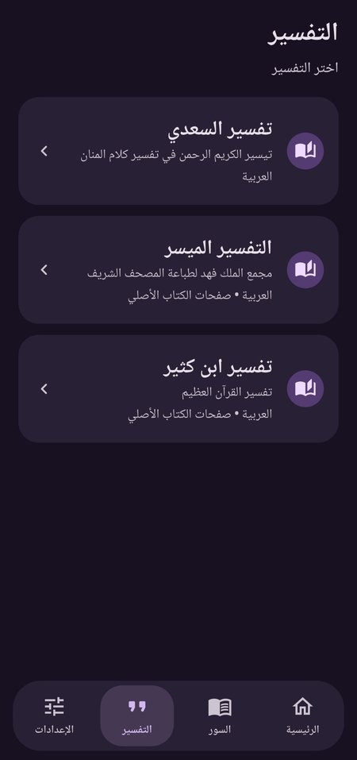
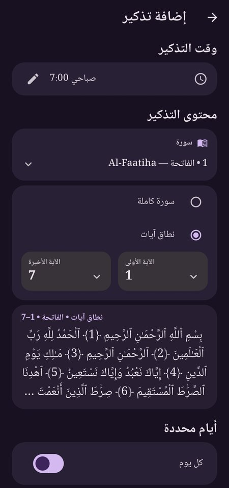
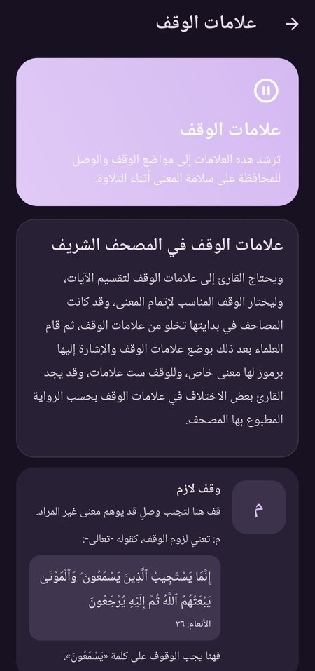
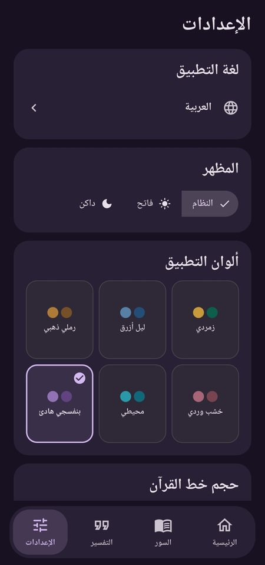

# القرآن الكريم — Quran Kareem

A standalone offline Quran reader for Android, built with Flutter and Dart.

The application is designed for comfortable Arabic reading with continuous Quran flow, Surah/Juz/Rubʿ navigation, Tafsir browsing, bookmarks, sharing, themes, multiple interface languages, and persistent local reminders. It does not require an account, backend, or runtime internet connection.

> **How this was made:** this app was generated with AI assistance (Manus). I wrote the requirements, tested it on a phone and reviewed the features. It is a hobby project that shows how I work with AI tools. It is not hand-written Flutter code.

> **Not included:** the two scanned Tafsir books (Al-Muyassar and Ibn Kathir) are not published here because of their size and copyright. The app's code for them is included, but those two readers need you to add your own PDF files. See [Tafsir PDFs](#tafsir-pdfs-not-included).

## Screenshots

<p>
  
  
  
  
</p>
<p>
  
  
  
  
</p>

*Home, Surah list, reader, Tafsir selection, reminders, waqf marks and settings. The two scanned Tafsir readers need PDFs that are not in this repository.*

## Features

### Quran reader

- All 114 Surahs.
- 6,236 exact Arabic Uthmani ayahs.
- Continuous, centered Arabic reading flow.
- Separate basmala presentation where applicable.
- Rotation-safe text wrapping for portrait and landscape layouts.
- Surah, Juz, Rubʿ, and ayah navigation.
- Quran search.
- Saved reading position.
- Inline ayah bookmarking with visible number highlighting.
- Zoom controls and fullscreen reading mode.
- Android Back button exits fullscreen mode.

### Tafsir

The app is built for three Tafsir sources (two need PDFs that are not in this repository):

- تفسير السعدي — indexed Arabic text reader.
- التفسير الميسر — original offline scanned pages with Quran-page navigation.
- تفسير ابن كثير — original offline scanned pages with Surah navigation and verified page anchors where available.

Tafsir selection includes themed wheel controls for choosing a work, Surah, and ayah. In the original build the PDF scans were bundled without OCR, transcription, translation, or alteration.

### Themes, language, and sharing

- Six light/dark theme families.
- Fourteen interface languages.
- Native-language scroll-wheel language selector.
- Quran content remains Arabic and is not translated.
- Share selected Quran ayahs or Tafsir excerpts as themed cards.
- Multi-card sharing keeps long selections readable.
- Waqf lessons and explanations with localized interface text.

### Local reminders

- Multiple independent Quran reading reminders.
- Whole-Surah or selected ayah-range reminders.
- Exact Arabic Uthmani ayah content in selected-range reminders.
- Live preview of the selected ayah range.
- Scroll-wheel start and end ayah selectors.
- Twelve-hour time picker with morning/evening selection.
- Every-day or selected-weekday recurrence.
- Persistent Android local notifications.
- Reboot rescheduling and notification permission tracking.
- Exact-alarm capability detection with inexact fallback where required by Android.

Reminder delivery in the background remains subject to Android and device-manufacturer notification, battery, and alarm policies.

## Technology

- **Flutter 3.47.0 stable**
- **Dart 3.13**
- **Java 17**
- **Android SDK 36**
- **Minimum Android API:** 24
- **Target Android API:** 36
- **Package:** `com.qurankareem.app`
- **Local persistence:** `shared_preferences`
- **Notifications:** `flutter_local_notifications`
- **PDF rendering:** Android native `PdfRenderer` adapter
- **No backend, account system, or runtime network dependency**

## Project structure

```text
lib/
├── app/                Theme and application-level configuration
├── controllers/        Persistent settings, bookmarks, progress, reminders
├── data/               Quran, Tafsir, and scanned-source repositories
├── models/             Quran, Tafsir, bookmark, and reminder models
├── screens/            Home, reader, Tafsir, settings, sharing, and reminders
├── services/           Notifications, PDF rendering, and local services
├── utils/              Formatting and navigation helpers
└── widgets/            Wheels, cards, readers, and reusable controls

assets/
├── data/quran.json                 Exact Arabic Quran data
├── data/tafsir_saadi.json          Indexed Al-Saadi text
├── data/tafsir_pdf_index.json      Scanned Tafsir navigation index
├── tafsir/                         (not included) put the two PDFs here
├── fonts/NotoNaskhArabic.ttf       Arabic reading font
└── images/icon.png                 Launcher and splash artwork

android/
└── app/src/main/kotlin/             Native PDF rendering adapter

test/                                Repository, widget, navigation, and persistence tests
scripts/                             Reproducible Tafsir asset/index tooling
source/                              Attribution and license notices
```

## Requirements

Install the following before opening the project:

- [Flutter 3.47.0 stable](https://docs.flutter.dev/get-started/install)
- Android Studio and Android SDK 36
- Java 17
- Visual Studio Code with the Flutter and Dart extensions, or another Flutter-compatible IDE

## Run locally

```bash
flutter doctor
flutter pub get
flutter analyze
flutter test --concurrency=1
flutter run
```

To run on a physical Android phone:

1. Enable Developer options and USB debugging.
2. Connect the phone by USB and approve the authorization prompt.
3. Confirm the phone appears in `flutter devices`.
4. Run `flutter run` or press **F5** in Visual Studio Code.

## Build an APK

```bash
flutter pub get
flutter build apk --release
```

The generated APK is located at:

```text
build/app/outputs/flutter-apk/app-release.apk
```

To install a development APK on a connected device:

```bash
adb install -r build/app/outputs/flutter-apk/app-release.apk
```

## Release signing

Never commit private keystores, passwords, `android/key.properties`, or other signing credentials to GitHub. The public source archive intentionally excludes private signing files.

The current source line is **v1.3.3+8**. Release builds are signed with a private key that is kept outside this repository.

For development, Flutter can use the local debug key. For distributable release builds, restore the private signing configuration securely before building and keep the backup outside the repository.

## Tafsir PDFs (not included)

The Al-Muyassar and Ibn Kathir scans are not part of this repository. Without them the Quran reader, search, bookmarks, reminders, sharing and the Al-Saadi tafsir work, but the two scanned readers cannot open.

To enable them, put your own legally obtained PDFs here:

```text
assets/tafsir/tafsir_muyassar.pdf
assets/tafsir/tafsir_ibn_kathir.pdf
```

Then add these two lines under `assets:` in `pubspec.yaml`:

```yaml
    - assets/tafsir/tafsir_muyassar.pdf
    - assets/tafsir/tafsir_ibn_kathir.pdf
```

The script `scripts/build-tafsir-pdf-index.py` rebuilds the navigation index from the original PDFs. It does not OCR, translate or rewrite their pages.

## Test and quality checks

```bash
dart format lib test
flutter analyze
flutter test --concurrency=1
```

The test suite covers Quran repositories, Tafsir navigation, scanned-page indexes, section boundaries, reminder persistence and scheduling plans, ayah wheels, language wheels, bookmark highlighting, sharing behavior, and responsive reader layouts.

## Data integrity and attribution

The Quran text is reproduced verbatim from **Tanzil Quran Text 1.1**. Preserve the notices and license in:

- `source/ATTRIBUTION.md`
- `source/TANZIL_LICENSE.txt`

The bundled Noto Naskh Arabic font is distributed under its SIL Open Font License. The scanned Tafsir PDFs are not distributed in this repository.

- [Tanzil text license](https://tanzil.net/docs/text_license)
- [Tanzil Uthmani text](https://tanzil.net/docs/uthmani)
- [Flutter Android deployment](https://docs.flutter.dev/deployment/android)
- [Android PdfRenderer](https://developer.android.com/reference/android/graphics/pdf/PdfRenderer)

## License

The application source code is released under the [MIT License](LICENSE).

The Quran text keeps the Tanzil license (Creative Commons Attribution 3.0, verbatim copies only), and the Noto Naskh Arabic font keeps its SIL Open Font License. See the `source/` folder. These terms are separate from the MIT license of the code.

---

*README drafted with AI assistance (Claude) and reviewed by the author.*
